# IMPLEMENTATION ROADMAP & PHASE GOVERNANCE
## Scientific Research & Experimental Methods Learning Hub
### Institut Teknologi Sumatera (ITERA)

> **Dokumen Status:** Proposed Baseline v2.0  
> **Klasifikasi:** Multi-Phase Operational Roadmap & Governance Gates  
> **Penyusun:** Aji Pamungkas Tri Nurcahyo  
> **Tanggal:** 22 November 2026

---

## 1. STRUKTUR FASE PENGEMBANGAN DAN GERBANG PERSETUJUAN

Pengembangan Learning Hub ini diorganisasikan ke dalam 6 fase bertahap dengan mekanisme gerbang persetujuan eksplisit (*Explicit Approval Gates*). Asisten AI dilarang melangkah ke fase berikutnya sebelum Project Creator memberikan persetujuan tertulis.

```mermaid
flowchart TD
    P0["PHASE 0: Master Curriculum & Academic Planning (RESET V2.0 - ACTIVE)"]
    G0{"GATE 0: Project Creator Approval of Master Curriculum v2.0"}
    P1["PHASE 1: Website Foundation & Academic Design System"]
    G1{"GATE 1: Verification of Static Shell, KaTeX & Navigation"}
    P2["PHASE 2: Core Curriculum Production (Levels 1, 2, 3 - Ch 01-23)"]
    G2{"GATE 2: Academic & Mathematical Verification of Core"}
    P3["PHASE 3: Advanced Methods & Validation (Levels 4, 5, 6 - Ch 24-44)"]
    G3{"GATE 3: Rigor Audit of DoE, ML Validation & Advanced Stats"}
    P4["PHASE 4: RSE, Labs, Templates & Capstone (Level 7, Labs, TMPL)"]
    G4{"GATE 4: Full Code Execution & Reproducibility Audit"}
    P5["PHASE 5: Public Deployment & Final Verification"]
    G5{"GATE 5: Final Authorization for GitHub Pages Deployment"}

    P0 --> G0
    G0 -->|Approved| P1
    P1 --> G1
    G1 -->|Approved| P2
    P2 --> G2
    G2 -->|Approved| P3
    P3 --> G3
    G3 -->|Approved| P4
    P4 --> G4
    G4 -->|Approved| P5
    P5 --> G5
```

---

## 2. RINCIAN TAHAPAN IMPLEMENTASI

### PHASE 0: Master Curriculum & Academic Planning (SEDANG BERJALAN)
- **Fokus Kerja:**
  - Academic Benchmarking terhadap standar formal internasional (ISO, GUM, NIST, COPE) dan literatur kanonikal.
  - Perancangan Research Competency Framework (5 tahap perkembangan, 17 kompetensi formal).
  - Redesain Master Curriculum v2.0 (7 Level, 17 Section, 51 Chapter, 174 Granular Lessons).
  - Pemetaan matriks prasyarat dan analisis graf ketergantungan (DAG).
  - Perancangan 10 Learning Paths terarah.
  - Perancangan katalog 15 Practical Research Laboratories dan 16 Research Templates.
  - Perancangan arsitektur website statis dan penetapan standar permanen anti-slop, bahasa, dan tipografi.
- **Deliverables:** Berkas dokumentasi dalam folder `docs/`, `README_PROJECT.md`, dan Laporan Redesain Phase 0.
- **Gerbang Kelulusan (Gate 0):** Persetujuan eksplisit dari Project Creator (Aji Pamungkas Tri Nurcahyo) atas dokumen Master Curriculum v2.0 dan kerangka kompetensi.

---

### PHASE 1: Website Foundation & Academic Design System
- **Fokus Kerja:**
  - Setup static site engine yang kompatibel penuh dengan GitHub Pages.
  - Implementasi tema visual akademik anti-slop (palet warna netral, tipografi berwibawa, rasio kontras WCAG AA $\geq 4.8:1$).
  - Integrasi rendering KaTeX untuk akselerasi rumus matematika instan tanpa pergeseran layout.
  - Pembangunan kerangka navigasi hierarkis (Level > Section > Chapter > Lesson) dan filter Learning Paths.
  - Implementasi print stylesheet (`@media print`) untuk ekspor PDF berkualitas buku ilmiah.
  - Implementasi LocalStorage progress tracking di sisi klien.
- **Deliverables:** Repositori website statis yang dapat dijalankan secara lokal dengan navigasi kosong lengkap dan satu halaman demo lesson terverifikasi.
- **Gerbang Kelulusan (Gate 1):** Verifikasi tampilan website di desktop dan mobile, pengujian kontras warna, audit rendering KaTeX, dan uji cetak PDF.

---

### PHASE 2: Core Curriculum Production (Batches 1 s.d. 3)
- **Fokus Kerja:** Penulisan konten lengkap 23 Chapter fondasi:
  - *Batch 1:* Level 1: Epistemology, Scientific Reasoning & Problem Formulation (CH-01 s.d. CH-07).
  - *Batch 2:* Level 2: Research Design, Measurement & Data Architecture (CH-08 s.d. CH-15).
  - *Batch 3:* Level 3: Statistical Foundations, Inference & Classical Analysis (CH-16 s.d. CH-23).
- **Deliverables:** 23 Chapter lengkap dengan 15 elemen kualitas wajib, kode Python dasar, visualisasi, dan slides.
- **Gerbang Kelulusan (Gate 2):** Audit kebenaran matematis, keterbacaan bahasa Indonesia akademik, dan verifikasi bahwa seluruh formula KaTeX ter-render sempurna.

---

### PHASE 3: Advanced Methods & Validation (Batches 4 s.d. 6)
- **Fokus Kerja:** Penulisan konten lengkap 21 Chapter tingkat lanjut:
  - *Batch 4:* Level 4: Statistical Modeling & Design of Experiments (CH-24 s.d. CH-31).
  - *Batch 5:* Level 5: Computational Validation, ML Rigor & Benchmarking (CH-32 s.d. CH-37).
  - *Batch 6:* Level 6: Advanced Inferential, Causal & Computational Methods (CH-38 s.d. CH-44).
- **Deliverables:** 21 Chapter tingkat lanjut dengan penurunan rumus DoE, GLM, UQ, Causal Inference, dan studi ablasi.
- **Gerbang Kelulusan (Gate 3):** Audit ketelitian formulasi DoE Montgomery, verifikasi metodologi perbandingan algoritma Demšar, dan audit independensi asumsi statistik.

---

### PHASE 4: Software Engineering, Publication, Labs & Templates (Batches 7 & 8)
- **Fokus Kerja:**
  - *Batch 7:* Level 7: Research Software Engineering, Reproducibility & Publication (CH-45 s.d. CH-51).
  - *Batch 8:* Pembuatan dan pengujian 15 modul Practical Research Laboratories (script Python, data simulasi, notebook) dan 16 Research Templates (Markdown, LaTeX, docx).
  - Eksekusi proyek Capstone (CH-51) sebagai demonstrasi paket riset reproduktif 1-klik.
- **Deliverables:** 7 Chapter Level 7, 15 modul laboratorium Python yang lulus uji toleransi numerik, dan 16 template akademik siap pakai.
- **Gerbang Kelulusan (Gate 4):** Eksekusi sukses seluruh 15 modul laboratorium pada lingkungan virtual Python bersih tanpa error (`exit code 0`).

---

### PHASE 5: Public Deployment & Final Verification
- **Fokus Kerja:**
  - Audit integritas seluruh tautan internal dan eksternal (*broken link checker*).
  - Audit performa Google Lighthouse (Target: Performance $\geq 95$, Accessibility $\geq 98$, Best Practices $\geq 100$).
  - Uji kompatibilitas render pada browser utama (Chrome, Firefox, Safari, Edge) dan perangkat layar sentuh.
  - Konfigurasi GitHub Actions untuk deployment otomatis ke GitHub Pages.
- **Deliverables:** Laporan Audit Kesiapan Rilis Publik (*Deployment Readiness Audit Report*).
- **Gerbang Kelulusan (Gate 5):** Persetujuan tertulis dari Project Creator untuk mempublikasikan repositori secara publik.

