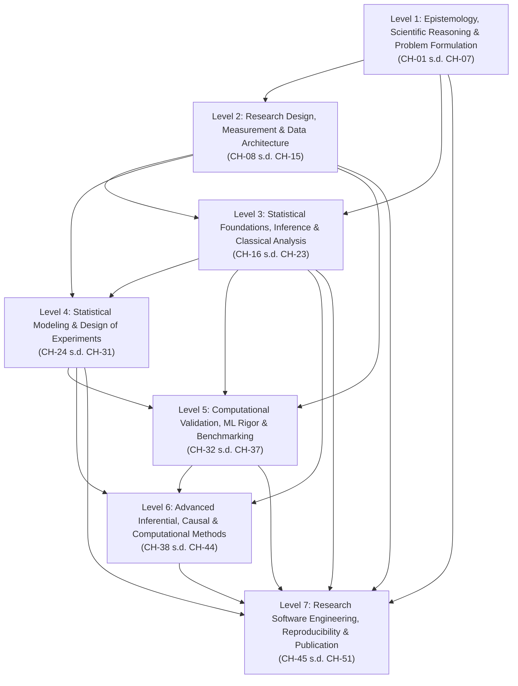

# PREREQUISITE DEPENDENCY MATRIX AND GRAPH
## Scientific Research & Experimental Methods Learning Hub
### Institut Teknologi Sumatera (ITERA)

> **Dokumen Status:** Proposed Baseline v2.0  
> **Klasifikasi:** Structural Dependency Analysis & Topological Verification  
> **Penyusun:** Aji Pamungkas Tri Nurcahyo  
> **Tanggal:** 22 November 2026

---

## 1. ANALISIS KETERGANTUNGAN PRASYARAT (PREREQUISITE GRAPH)

Untuk memastikan kelancaran perkembangan kognitif pembelajar dan mencegah kesenjangan pemahaman (*knowledge gaps*), seluruh 51 Chapter dalam Master Curriculum dihubungkan melalui graf berarah tanpa siklus (Directed Acyclic Graph - DAG). Setiap hubungan ketergantungan diverifikasi untuk menjamin:
1. Tidak ada dependensi melingkar (*no circular dependencies*).
2. Setiap materi lanjutan memiliki jalur prasyarat yang jelas dan tidak terputus.
3. Titik masuk (*entry points*) terdefinisi secara eksplisit.
4. Terdapat simpul gerbang utama (*gateway milestone chapters*) yang menyatukan kompetensi sebelum materi bercabang ke tingkat spesialisasi.

---

## 2. DIAGRAM ALIR TINGKAT TINGGI (LEVEL-TO-LEVEL ARCHITECTURE)

---

## 3. MATRIKS KETERGANTUNGAN LENGKAP 51 CHAPTER

| Kode Chapter | Judul Chapter | Direct Prerequisites | Downstream Dependent Chapters | Kompetensi Terkait |
| :--- | :--- | :--- | :--- | :--- |
| **CH-01** | Epistemology, Scientific Reasoning & Demarcation | *None (Entry)* | CH-02, CH-07, CH-15 | COMP-FND-01 |
| **CH-02** | Research Problems, Scoping & Objectives | CH-01 | CH-03, CH-06, CH-15 | COMP-FND-02 |
| **CH-03** | Systematic Literature Search & PRISMA | CH-02 | CH-04, CH-15 | COMP-FND-03 |
| **CH-04** | Critical Evidence Synthesis & Bibliometrics | CH-03 | CH-05, CH-15 | COMP-FND-03 |
| **CH-05** | Research Gaps & Novelty Formulation | CH-04 | CH-06, CH-33, CH-48, CH-50 | COMP-FND-04 |
| **CH-06** | Hypotheses & Conceptual Frameworks | CH-02, CH-05 | CH-08, CH-43 | COMP-FND-01, COMP-FND-02 |
| **CH-07** | Research Ethics, Integrity & Provenance | CH-01 | CH-14, CH-47 | COMP-FND-05 |
| **CH-08** | Taxonomy of Research Designs & Validity | CH-06 | CH-09, CH-13, CH-28, CH-32 | COMP-APP-01 |
| **CH-09** | Variables, Operationalization & Scales | CH-08 | CH-10, CH-11, CH-12, CH-16 | COMP-APP-02 |
| **CH-10** | Sampling Theory & Data Collection Protocols | CH-09 | CH-11, CH-14 | COMP-APP-03 |
| **CH-11** | Metrology, Calibration & GUM Uncertainty | CH-09, CH-10 | CH-12, CH-41 | COMP-EXP-01 |
| **CH-12** | Measurement Validity, Reliability & Agreement | CH-09, CH-11 | CH-13 | COMP-APP-02, COMP-EXP-01 |
| **CH-13** | Experimental & Quasi-Experimental Setups | CH-08, CH-12 | CH-15, CH-28 | COMP-APP-01, COMP-EXP-02 |
| **CH-14** | Research Data Management, FAIR & Versioning | CH-07, CH-10 | CH-15, CH-45, CH-47 | COMP-FND-05, COMP-IND-01 |
| **CH-15** | Research Proposal & Protocol Engineering | CH-01 s.d. CH-14 | CH-48, CH-51 | COMP-FND-02, COMP-APP-01 |
| **CH-16** | Exploratory Data Analysis & Outlier Forensics | CH-09 | CH-17, CH-22, CH-23, CH-24, CH-32 | COMP-APP-04 |
| **CH-17** | Probability Theory & Parametric Distributions | CH-16 | CH-18, CH-19, CH-39 | COMP-APP-04, COMP-APP-05 |
| **CH-18** | Parameter Estimation & Sampling Distributions | CH-17 | CH-19, CH-20, CH-38, CH-39 | COMP-APP-05 |
| **CH-19** | NHST & Pitfalls of P-Values | CH-17, CH-18 | CH-20, CH-21, CH-22, CH-24, CH-26 | COMP-APP-05 |
| **CH-20** | Confidence Intervals, Effect Sizes & Practical Significance | CH-18, CH-19 | CH-23, CH-24, CH-38 | COMP-APP-05 |
| **CH-21** | Multiple Testing & False Discovery Rate | CH-19 | CH-34 | COMP-EXP-04 |
| **CH-22** | Nonparametric & Distribution-Free Methods | CH-16, CH-19 | CH-34 | COMP-EXP-04 |
| **CH-23** | Scientific Data Visualization & Perceptual Principles | CH-16, CH-20 | CH-48 | COMP-APP-04, COMP-IND-03 |
| **CH-24** | Linear Regression & OLS Residual Diagnostics | CH-16, CH-19, CH-20 | CH-25, CH-26, CH-27, CH-40, CH-43, CH-44 | COMP-EXP-03 |
| **CH-25** | Generalized Linear Models (GLM) | CH-24 | CH-27 | COMP-EXP-03 |
| **CH-26** | Analysis of Variance (ANOVA) & Post-Hoc Contrasts | CH-19, CH-24 | CH-27, CH-28 | COMP-EXP-02, COMP-EXP-03 |
| **CH-27** | Linear Mixed-Effects & Hierarchical Models | CH-24, CH-26 | CH-44 | COMP-EXP-03 |
| **CH-28** | DoE Foundations & Fisher Axioms | CH-08, CH-26 | CH-29 | COMP-EXP-02 |
| **CH-29** | Full Factorial Experiments ($2^k$ Designs) | CH-28 | CH-30, CH-31, CH-35 | COMP-EXP-02 |
| **CH-30** | Fractional Factorial & Screening Designs | CH-29 | CH-31 | COMP-EXP-02 |
| **CH-31** | Advanced Blocking, Latin Squares & RSM | CH-29, CH-30 | CH-35 | COMP-EXP-02 |
| **CH-32** | Data Leakage Forensics & Validation Architectures | CH-08, CH-16 | CH-33, CH-36, CH-37 | COMP-IND-02 |
| **CH-33** | Rigorous Baseline Selection & Benchmarking | CH-05, CH-32 | CH-34, CH-35, CH-37 | COMP-IND-02 |
| **CH-34** | Statistical Comparison of Algorithms (Demšar) | CH-21, CH-22, CH-33 | CH-35, CH-51 | COMP-IND-02 |
| **CH-35** | Systematic Component Ablation Study Design | CH-29, CH-33 | CH-36, CH-48 | COMP-IND-02 |
| **CH-36** | Algorithmic Robustness & OOD Evaluation | CH-32, CH-35 | CH-51 | COMP-IND-02 |
| **CH-37** | Hyperparameter Tuning & Random Seed Sensitivity | CH-32, CH-33 | CH-40 | COMP-IND-02 |
| **CH-38** | Bootstrap & Resampling Foundations | CH-18, CH-20 | CH-51 | COMP-EXP-04 |
| **CH-39** | Bayesian Statistical Analysis & MCMC | CH-17, CH-18 | CH-41 | COMP-DOC-02 |
| **CH-40** | Scientific Computing, Conditioning & Stability | CH-24, CH-37 | CH-45 | COMP-IND-01 |
| **CH-41** | Uncertainty Quantification (UQ) & Conformal Prediction | CH-11, CH-39 | CH-42 | COMP-DOC-02 |
| **CH-42** | Global Sensitivity Analysis & Sobol Indices | CH-41 | CH-51 | COMP-DOC-02 |
| **CH-43** | Causal Inference & Structural Causal Models | CH-06, CH-24 | CH-51 | COMP-DOC-03 |
| **CH-44** | Longitudinal & Time-Series Experimental Analysis | CH-24, CH-27 | CH-51 | COMP-EXP-03 |
| **CH-45** | Research Software Engineering (RSE) Principles | CH-14, CH-40 | CH-46 | COMP-IND-01 |
| **CH-46** | Computational Reproducibility & Docker Virtualization | CH-45 | CH-51 | COMP-IND-01 |
| **CH-47** | Electronic Lab Notebooks & Provenance Tracking | CH-07, CH-14 | CH-51 | COMP-FND-05, COMP-IND-01 |
| **CH-48** | Scientific Writing & Claims-to-Evidence Architecture | CH-05, CH-23, CH-35 | CH-49, CH-50, CH-51 | COMP-IND-03 |
| **CH-49** | Journal Selection, Peer Review & Rebuttal | CH-48 | CH-50, CH-51 | COMP-IND-04 |
| **CH-50** | Multi-Year Research Programme & Doctoral Roadmap | CH-05, CH-48, CH-49 | CH-51 | COMP-DOC-01, COMP-DOC-04 |
| **CH-51** | Capstone: End-to-End Reproducible Research Package | All (CH-01 s.d. CH-50) | *Final Project* | All Competencies |

---

## 4. GATEWAY MILESTONE CHAPTERS

Terdapat 7 simpul gerbang kritis (*gateway milestone chapters*) yang menjadi titik konsolidasi sebelum pembelajar dapat melanjutkan ke modul spesialisasi yang lebih rumit:

1. **CH-06 (Hypotheses & Conceptual Frameworks):** Gerbang transisi dari penelusuran pustaka konseptual menuju perancangan desain empiris formal.
2. **CH-15 (Research Proposal & Protocol Engineering):** Gerbang sintesis Level 1 dan Level 2. Wajib dituntaskan sebelum mengeksekusi eksperimen laboratorium atau komputasi.
3. **CH-20 (Confidence Intervals, Effect Sizes & Practical Significance):** Gerbang inferensi statistik. Memastikan peneliti tidak terjebak pada dikotomi p-value sebelum masuk ke pemodelan statistik lanjutan.
4. **CH-24 (Linear Regression & OLS Diagnostics):** Gerbang pemodelan statistik (Level 4, Level 5, dan Level 6). Pemahaman mendalam atas aljabar OLS dan residual diagnostics menjadi fondasi GLM, ANOVA, dan Causal Inference.
5. **CH-29 (Full Factorial Experiments):** Gerbang eksperimen multifaktor. Menjadi dasar bagi studi ablasi komputasi (CH-35) dan optimasi permukaan respon (CH-31).
6. **CH-33 (Rigorous Baseline Selection & Benchmarking):** Gerbang komputasi ilmiah dan machine learning. Memastikan pembelajar tidak mengevaluasi algoritma pada fondasi perbandingan yang cacat.
7. **CH-48 (Scientific Writing & Claims-to-Evidence Architecture):** Gerbang komunikasi akademik. Menghubungkan seluruh bukti data mentah menjadi naskah publikasi yang siap dipertahankan di hadapan peer reviewer.

